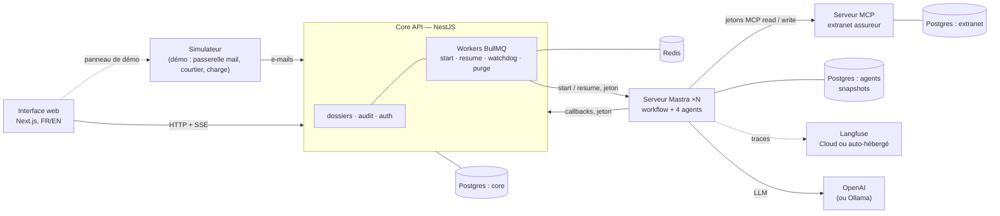

# Claims desk — AI agents for an insurance brokerage (demo)

[English](#english) · [Français](#français)

A demo built for my application to Panora. / Une démo construite pour ma candidature chez Panora.

# English

## Why this project

I built this demo for my application to **Panora** (Founding Senior Full Stack Engineer). Rather
than describe what I can do, I wanted to show it on Panora's own domain: AI agents that handle a
brokerage's e-mails reliably, with a human in the loop, tracing, evals and an audit trail. It is a
demonstration, not a product, and **all data is fictional** (generated from a fixed seed).

## What it does

An e-mail reaches an insurance brokerage: a claim, a cancellation, a coverage question, a quote
request, a follow-up, spam.

- **AI agents** read the e-mail and its PDF attachments, find the client, and sort the request.
- They **check the policy at the insurer** through an MCP server (read-only): status, coverages,
  limits, deductibles, exclusions, claim history — and cite the clauses.
- They **propose an action** (file the claim, cancel, ask for documents, explain a denial) with the
  reply to the client, in the client's language.
- **The broker approves or rejects** (with a comment the agent applies). Only then is anything
  filed at the insurer, with a separate write token. Every step is audited and traced.

Highlights: the insurer's view can contradict the brokerage's (a policy terminated for non-payment
that the brokerage still believes active), a PDF carrying a hidden prompt injection is detected and
neutralised, the UI is bilingual FR/EN, agents are scored by evals in CI, and 1,000 cases were run
with an instance killed mid-run and nothing lost.

Stack: TypeScript, Next.js, NestJS, Prisma/PostgreSQL, BullMQ/Redis, Mastra, MCP (official SDK),
Langfuse, Docker Compose, GitHub Actions.

## Quick start (5 minutes)

You need **Node.js 24+**, **Docker** (Docker Desktop running) and, to see the real agents, an
**OpenAI API key** (the whole 26-e-mail demo costs a few cents). No key? The demo also runs with
deterministic stand-ins for the agents.

```bash
git clone https://github.com/jb-pro-beirnaert/panora-demo.git
cd panora-demo
npm install
npm run setup:env
```

`setup:env` creates `.env` from `.env.example` with random secrets. Open `.env` and set **one** of:

```bash
OPENAI_API_KEY=sk-...        # real agents (default models: gpt-5-nano / gpt-6-luna)
AGENTS_MODE=simulated        # or: no LLM, canned agent outputs, same workflow and UI
```

Then start everything (Postgres, Redis and the five apps; databases start empty and are seeded):

```bash
npm run dev:lite
```

`npm run dev` does the same plus a self-hosted Langfuse on http://localhost:3100 (more containers,
more RAM; login `demo@panora-demo.local` / `demo-password`). The first start pulls the Docker
images and takes a few minutes; the stack is ready when http://localhost:3000 loads.

**What to try** on http://localhost:3000 (no sign-in: you are Sophie Marchal, broker at Delorme
Courtage):

1. Press **Send 1 e-mail** in the demo panel (or **Play**: one e-mail every 20 s) and watch the
   pipeline Triage → Coverage → Drafting → Approval → Execution fill in live.
2. **E-mail 2** — the flagship case: the brokerage believes the policy is active, the insurer says it
   was terminated for non-payment. The agent spots the mismatch and cites the clause; click the
   sources to open the policy and the clause at the insurer.
3. **E-mail 3** — a PDF invoice carries a hidden instruction to the AI (multiply the amount, drop
   the deductible, change the IBAN). It is flagged, ignored by the agents, and approval needs an
   explicit confirmation.
4. **Approve** a proposal (the claim is filed at the insurer with a write token, the reply to the
   client gets its claim number) or **reject it with a comment** (the drafting agent rewrites it).
5. Switch the UI between **FR / EN**; open the **Insurer extranet** and **Clients** tabs, the audit
   log, and the "For you to handle" column (quotes and certificates are handed to the broker).

Stop with `Ctrl+C`, then `npm run infra:down` to remove the containers. Nothing persists: the next
start is a fresh demo.

## The journey of a case

1. **E-mail in.** The mail gateway (the simulator, in the demo) posts the e-mail to Core, which
   opens a case and queues a job; the worker starts a Mastra workflow and returns at once.
   PDF attachments are converted to text in reading order; before any agent runs, a rule looks for
   injected instructions in the e-mail and the attachments and fences them as untrusted text.
2. **Triage** (`triageAgent`, light model): request type (claim, cancellation, question, quote,
   follow-up, unrelated), the client (looked up in the brokerage's records with a `find_client`
   tool), policy number, date, peril, amount, documents present and missing, e-mail language — each
   fact with its source (e-mail, attachment page) and confidence. Then the workflow branches: claims
   go on below; cancellations and coverage questions go to `policyServiceAgent` (read tools, same
   approval loop, cancellation filed through MCP `request_cancellation`); follow-ups are attached to
   their case; quotes and certificates are handed to the broker with the reason; spam is classified.
3. **Coverage** (`coverageAgent`, read-only MCP tools on the insurer's extranet): policy status
   at the insurer — which may contradict what the brokerage believes (the flagship case: a policy
   terminated for non-payment that the brokerage still shows as active) — coverages, limits,
   deductibles, exclusions, claim history, declaration delay; a verdict (`covered`, `not_covered`,
   `uncertain`) with alerts and **verbatim clause citations**.
4. **Drafting** (`draftingAgent`, no tools): the action (`file_claim`, `notify_denial`,
   `request_documents`), the e-mail to the client in the client's language, and an internal note in
   the brokerage's language.
5. **Human approval.** The workflow suspends (snapshot in Postgres, survives restarts); the broker
   approves, or rejects with a comment that the drafting agent applies in a new proposal.
6. **Execution.** Only now, in code and with a separate `write` token, the claim is filed through
   MCP (`file_claim`); other actions become "ready to send". Everything lands in the audit trail,
   the UI follows each step and each tool call live (SSE), and Langfuse holds one trace per case.
   Every source the agents used (policy, coverage, clause, client, attachment page) is a link, with
   what the tool returned to the agent at the time.

## Architecture


| Service                                                          | Directory                                                             | Port | Database   |
| ---------------------------------------------------------------- | --------------------------------------------------------------------- | ---- | ---------- |
| Web (Next.js 16, next-intl, shadcn/ui)                           | `apps/web`                                                            | 3000 | —          |
| Core API (NestJS 12, Prisma, BullMQ)                             | `apps/core-api`                                                       | 3001 | `core`     |
| MCP extranet server (official TypeScript SDK, Streamable HTTP)   | `apps/mcp-extranet`                                                   | 3002 | `extranet` |
| Simulator (demo tool)                                            | `apps/simulator`                                                      | 3003 | —          |
| Mastra server (workflow, agents)                                 | `apps/agents`                                                         | 4111 | `agents`   |
| Shared Zod contracts · fictional world generator · PDF rendering | `packages/shared` · `packages/world-generator` · `packages/documents` |      |            |
| Evals                                                            | `evals/`                                                              |      |            |

One database per service, Zod on every boundary, Postgres on tmpfs and Redis without persistence:
every `npm run dev` starts from empty databases that the simulator seeds again.

## Design choices and trade-offs

- **Microservices around one product.** Core owns the business data and the audit; Mastra owns
  the reasoning and its snapshots; the MCP server plays the insurer's extranet behind the protocol
  Panora's connectors speak. More moving parts than a monolith, but each boundary is a real one
  (an insurer is another company; agents must not touch the brokerage's database) and is enforced
  by tokens and tested.
- **Several agents rather than one.** The measured single agent is as accurate and cheaper on a small
  sample (V8). Separate agents are kept because each one is evaluated and traced on its own, a light
  model does the triage, only the analysis agent gets tools — read-only — and a rejected draft is
  rewritten without re-running the analysis.
- **Mastra in framework mode, behind Core.** Core never waits for a workflow (it starts or resumes
  and returns); progress comes back through callbacks; suspended runs survive restarts; several
  Mastra instances share their storage.
- **Least privilege by construction.** Agents only hold read tools; writes happen in a code step
  after human approval with a separate `write` token; the token carries the brokerage, so a prompt
  cannot reach another brokerage's policies.
- **Attachments are data, never instructions.** A PDF can carry text aimed at the model. Detection
  runs in code before the agents, the passages are fenced as untrusted, every prompt says content is
  data, the alert is added by code whatever the model answers, and the write step refuses to run
  without the broker's explicit confirmation (checked again by Core). Detection is a rule, not a
  guarantee: the human approval and the read-only tools are what bound the damage.
- **One English prompt per agent for a bilingual product.** Structured outputs use neutral values;
  the languages are passed explicitly (draft in the e-mail's language, note in the brokerage's,
  clauses quoted in their own language); the UI renders stored `type + params`, so the timeline
  follows the UI language. Measured per language in the evals.
- **Langfuse, self-hostable.** Business audit in Core, technical detail (prompts, tokens, cost) in
  Langfuse; switching Cloud ↔ self-hosted is a `.env` change.
- **Cheap models, measured.** The defaults are small OpenAI models chosen with the comparison table
  below; the evals gate any prompt or model change in CI.

## Results at a glance

- **Evals** (real models, samples to fit the budget): 100 % on every strict scorer (request type,
  fields, language, verdict, limits, citations, action, amounts, languages) on 6 French and 4
  English cases; LLM judge for tone and completeness 75–83 %. A deliberately degraded prompt is
  blocked by the gate (`drafting/action_type` 100 → 50). [`evals/reports/`](evals/reports/)
- **Cost**: **$0.0034 per case** for the whole workflow (≈ 62 % of input tokens served from the
  prompt cache); triage on a smaller model halves it at equal score.
- **Load**: 1,000 cases in a burst against a flaky extranet (5 % errors) with a Mastra instance
  killed mid-run: **1,000 closed, 0 failed, 0 processed twice**, 299 cases/min (the rate limit).
- **Isolation**: MCP tokens are scoped to a brokerage and to `read` / `write`; suite green in CI.

## Run it locally — details

The short version is the [Quick start](#quick-start-5-minutes). `npm run dev` also creates `.env`
on its own if it is missing (same random secrets), then starts Postgres and Redis (empty), a
self-hosted Langfuse, the five apps in watch mode, and seeds the fictional world.

The demo has one brokerage (Delorme Courtage) and one broker (Sophie Marchal), and every e-mail
lands in her inbox. It plays a fixed script of 26 e-mails (4 in English) covering every case of the
catalog (claims, cancellations, questions, certificates, quotes, spam, follow-ups, duplicates; the
terminated-policy case comes second, the injected PDF third), with real PDF attachments (invoices,
incident reports, police receipts, fire reports): press **Play** (one e-mail every 20 s) or **Send
1 e-mail** in the demo panel, which shows "Demo · 7/26 e-mails sent". Every request ends with a reply proposed to the broker, "For you
to handle" (with the reason), or classified. Each e-mail pops in with a toast,
its row shows a live pipeline (Triage → Coverage → Drafting → Approval → Execution) with the agent
at work and the MCP tool it is calling, the "Live agents" panel shows what each Mastra agent is
doing, and a list/board toggle shows cases moving between columns. Approve or reject the
proposals; each case links to its run in Mastra Studio and its trace in Langfuse. Switch the UI
between FR and EN at any time. Other entry points: Mastra Studio on
http://localhost:4111, Langfuse on http://localhost:3100 (`demo@panora-demo.local` /
`demo-password`), the Evals screen, `npm run evals`, `npm run load-test -w apps/simulator`.

| Command                                                                    | What it does                                           |
| -------------------------------------------------------------------------- | ------------------------------------------------------ |
| `npm run setup:env`                                                        | create `.env` from `.env.example` (random secrets)     |
| `npm run dev` / `npm run dev:lite`                                         | the stack with self-hosted Langfuse on :3100 / without |
| `npm run build` / `lint` / `typecheck` / `test` / `test:integration`       | across all workspaces                                  |
| `npm run gen:evals -- --seed 7 --count 60` · `npm run evals [-- --matrix]` | eval dataset, eval run, model matrix                   |
| `npm run start:docker`                                                     | the full stack in containers (Compose profile `apps`)  |
| `npm run infra:down`                                                       | stop and remove the containers                         |

## Tracing: Langfuse, self-hosted by default

The Mastra server exports its traces to Langfuse: one trace and one session per case (initial run
and every resume), with the model, the prompt version and the e-mail language on the agents' spans,
and tokens and cost on every LLM call. The UI's audit log links to the trace.

- **Self-hosted (default)**: `npm run dev` starts Langfuse with the stack (web UI on
  http://localhost:3100, worker, ClickHouse, MinIO, Redis; Compose profile `langfuse`, no volume).
  The project, its keys and a login are created on startup and `.env.example` already points to
  them, so "View the trace" opens the local trace. `npm run dev:lite` skips Langfuse (tracing off,
  no trace links) for a smaller machine.
- **Cloud**: set `LANGFUSE_PUBLIC_KEY`, `LANGFUSE_SECRET_KEY`, `LANGFUSE_BASE_URL` and
  `NEXT_PUBLIC_LANGFUSE_URL` / `NEXT_PUBLIC_LANGFUSE_PROJECT_ID` in `.env` — same code, only the
  URL and the keys change.

### Why self-host in a regulated sector — and what it costs

- Traces contain prompts, claim e-mails, policy numbers and client names: personal and
  commercially sensitive data. Self-hosting keeps them inside the brokerage's infrastructure (and
  its hosting region), under its own access control and retention rules, with no extra
  sub-processor to declare.
- The cost is operational: five more containers (web, worker, ClickHouse, object storage, Redis)
  on top of Postgres, to size, monitor, upgrade (Langfuse ships often and ClickHouse migrations run
  on startup), secure (SSO, network policies) and back up (Postgres, ClickHouse and the bucket —
  deliberately not done here: the demo runs on tmpfs). Cloud is the better default until the data
  or contractual constraints require self-hosting.

## Cost, latency and model choice

Every model choice is backed by `npm run evals -- --matrix` (configurations in
[`evals/matrix.json`](evals/matrix.json)): each row changes one agent's model against the baseline,
or the architecture, or applies one optimisation. Models are switched **per case** (run options
passed from the eval runner through Core to Mastra), so the whole matrix runs against one server.
Cost comes from the Langfuse traces (sum of the LLM generations of the case), latency is the time
from `POST /emails` to the first proposal.

Sample: 6 cases per configuration (same cases for every row).

| Configuration             | Agent    | Model                                                       | Agent score |    FR |    EN | Cases correct | Cost / case | Latency p50 / p95 |
| ------------------------- | -------- | ----------------------------------------------------------- | ----------: | ----: | ----: | ------------: | ----------: | ----------------: |
| baseline                  | workflow | `openai/gpt-5-nano / openai/gpt-6-luna / openai/gpt-6-luna` |       100.0 | 100.0 | 100.0 |         100.0 |     $0.0034 |       78 s / 98 s |
| triage: gpt-4.1-mini      | triage   | `openai/gpt-4.1-mini`                                       |       100.0 | 100.0 | 100.0 |          66.7 |     $0.0033 |       32 s / 40 s |
| triage: gpt-5.4-nano      | triage   | `openai/gpt-5.4-nano`                                       |        97.2 |  95.8 | 100.0 |         100.0 |     $0.0018 |       31 s / 31 s |
| coverage: gpt-5.4-mini    | coverage | `openai/gpt-5.4-mini`                                       |        86.1 |  90.6 |  77.1 |         100.0 |     $0.0082 |       63 s / 65 s |
| coverage: gpt-4.1-mini    | coverage | `openai/gpt-4.1-mini`                                       |        83.3 |  87.5 |  75.0 |         100.0 |     $0.0096 |       64 s / 79 s |
| drafting: gpt-5-nano      | drafting | `openai/gpt-5-nano`                                         |        94.4 |  91.7 | 100.0 |          83.3 |     $0.0047 |      97 s / 107 s |
| drafting: gpt-4.1-mini    | drafting | `openai/gpt-4.1-mini`                                       |        88.9 |  91.7 |  83.3 |          83.3 |     $0.0036 |       56 s / 73 s |
| single agent (gpt-6-luna) | workflow | `openai/gpt-6-luna (one agent)`                             |       100.0 | 100.0 | 100.0 |         100.0 |     $0.0015 |       42 s / 65 s |
| reduced context           | workflow | `openai/gpt-5-nano / openai/gpt-6-luna / openai/gpt-6-luna` |        83.3 |  75.0 | 100.0 |          83.3 |     $0.0030 |       60 s / 73 s |

"Agent score" is the mean of the varied agent's scorers; "Cases correct" is the share of cases where
triage, verdict, action and amounts are all right.

**Reading it.** The sample is deliberately small (6 cases × 10 configurations ≈ $0.25 in API costs),
so one case flipping moves a column by 17 points: these numbers rank options, the full 60-case run
confirms them.

- **Triage**: `gpt-5.4-nano` scores like the baseline `gpt-5-nano` for **half the cost per case**
  ($0.0018 vs $0.0034) and less than half the latency: `gpt-5-nano` spends thousands of reasoning
  tokens on an extraction task. It is the next default to adopt once the full run confirms it.
  `gpt-4.1-nano` was also tried and is deprecated by OpenAI.
- **Coverage** is where quality is decided: the cheaper `gpt-5.4-mini` / `gpt-4.1-mini` keep the
  verdicts but lose points on alerts and citations, mostly on English cases, and cost _more_ per
  case (more tool round-trips and more tokens re-sent): `gpt-6-luna` stays.
- **Drafting**: `gpt-5-nano` and `gpt-4.1-mini` each picked a wrong action once: `gpt-6-luna` stays.
- **One agent vs three**: on this sample the single agent (same model, the three prompts merged) is
  as accurate and cheaper ($0.0015 vs $0.0034, one context instead of three). The three-agent
  design is kept for what the table does not show: a light model can do triage, each agent is
  evaluated and traced separately (a regression points to one prompt), the agents with tools are
  limited to read tools, and a rejected draft is rewritten without re-running the analysis.
- **Optimisations measured**:
  - _Prompt caching_: OpenAI caches stable prompt prefixes automatically; the agents' instructions
    come first and never change per case, so **62 %** of the input tokens of a baseline case are
    already served from the cache (75 % with the reduced context).
  - _Reduced context_ (photos dropped from the attachments, no attachments for the drafting agent):
    −12 % cost per case, 83 % of cases correct, above the 50 % threshold.
  - _Smaller model where the score holds_: triage on `gpt-5.4-nano` (above).
- **Local model**: `ollama/qwen3:4b` rows are in the matrix (`--with-ollama`, Compose profile
  `ollama`, `docker compose exec ollama ollama pull qwen3:4b`); not run here.

## Scale and resilience

`npm run load-test -w apps/simulator -- --count 1000` resets the demo, starts a simulated broker
(immediate approval), sends a burst of generated e-mails with their PDFs straight to Core (~5 %
duplicate e-mails) and follows Core's `/cases/metrics` until every case is closed. (Since V14 the
load test is self-contained: the demo panel no longer has a burst button.)

**Setup of the reference run** (results in [`docs/load-tests/`](docs/load-tests/)): two Mastra
instances sharing their storage (Core round-robins and fails over between them), the extranet in
"flaky" mode (5 % of tool calls answered 503, 50–400 ms latency), BullMQ workers limited to 300
workflow starts per minute (the LLM quota we would buy), and **one Mastra instance killed (`kill -9`)
8 s into the burst**, while a hundred workflows were running on it. To keep the test free, the agents
run in `AGENTS_MODE=simulated`: the same workflows, MCP calls, suspension, approval and resume, with
deterministic stand-ins (4 s per agent) instead of LLM calls.

| Measure                                                            |                                                             1,000-case burst |
| ------------------------------------------------------------------ | ---------------------------------------------------------------------------: |
| Cases created / closed / failed                                    |                                                        1,000 / 1,000 / **0** |
| Duplicate e-mails sent / extra cases                               |                                    43 / **0** (1,000 distinct workflow runs) |
| Throughput                                                         |                                           **299 cases/min** (the rate limit) |
| Duration per case (reception → closed), p50 / p95                  |                            86 s / 191 s (mostly queueing behind the limiter) |
| Runs interrupted by the killed instance, restarted by the watchdog |                                                                          104 |
| Extranet errors injected / MCP retry rate                          |                                                    205 / 2.9 % of tool calls |
| Definitive failure rate                                            |                                                                      **0 %** |
| LLM cost of the test                                               | $0 (simulated) — about **$3.40** with the real models ($0.0034 per case, V8) |

How it holds:

- **No double processing**: job id = e-mail id, `messageId` unique in Core, and the worker claims a
  case atomically before creating its run.
- **Retries everywhere, with increasing delays**: BullMQ jobs (3 attempts), each MCP tool call
  (4 attempts on timeouts, 429 and 5xx — invisible to the broker when it succeeds), each workflow
  step (3 attempts), and explicit timeouts on every HTTP, MCP and LLM call.
- **Instance loss**: Core fails over to another Mastra instance; a watchdog (BullMQ repeated job,
  every 30 s) restarts the runs that stopped progressing from their last snapshot, re-sends lost
  resumes, and marks a case failed after 3 restarts. Failed cases show their reason in the UI and
  can be relaunched.
- Two bugs were found by these tests and fixed: the watchdog re-queued cases that were only
  waiting behind the rate limiter (now it skips cases with a pending job), and a stopping Core waited
  forever for open SSE streams (they now complete on shutdown, and the SSE client reconnects after
  45 s of silence).

## Security and personal data

**Access.** The demo runs locally for a single broker, so the UI has no sign-in (V12; V10 had
sessions and per-brokerage filtering, removed to keep the demo about the agents). Every decision
is recorded under that broker, and decisions of the simulated broker are marked "auto". The
brokerage's `brokerCode` travels with the case to Mastra and into the MCP token, so an agent
cannot read another brokerage's policies at the insurer whatever its prompt says. Each hop has
its own credential: inbound e-mail gateway → Core, Core → Mastra, Mastra → Core, Mastra → MCP
(`read` for the agents, `write` only in the code step after approval), simulator → `/admin/*`
(which only exists with `DEMO_MODE=true`). These rules are covered by test suites that run in CI
(Core API and MCP server, real Postgres).

**Data processed.** Claim e-mails and their attachments (names, addresses, company identifiers,
amounts, circumstances of incidents), policy data from the insurer, drafts and internal notes, the
brokers' decisions. All data in this demo is generated: no real person is involved.

| Where                      | What                                                 | Kept                                                     |
| -------------------------- | ---------------------------------------------------- | -------------------------------------------------------- |
| Core (`core` database)     | cases, e-mails, steps, proposals, decisions          | the case file's legal retention (not purged by the demo) |
| Core `AuditLog`            | who did what, when                                   | append-only: no route updates or deletes it              |
| Mastra (`agents` database) | workflow snapshots (e-mail, extracted facts, drafts) | purged `RETENTION_DAYS` (30) after the case closes       |
| Langfuse                   | prompts, completions, tokens, costs                  | trace deleted with the snapshot                          |
| Redis                      | jobs in flight                                       | short-lived (completed jobs trimmed)                     |

The purge is a BullMQ repeated job in Core: it asks Mastra to delete the snapshots and the Langfuse
traces of cases closed for longer than the retention delay, marks the case and writes an audit row.

**What production would add**: encryption at rest (database, backups, object storage) and in
transit between services (TLS/mTLS), hosting in France (HDS-grade providers are not required for
claims data, but EU hosting and a data processing agreement with the LLM provider are), secrets in a
vault with rotation, SSO for brokers with MFA, periodic access reviews, a records-of-processing
entry and a DPIA for the automated analysis, PII redaction in traces, and a retention policy agreed
with the brokerage's DPO for the case files themselves.

## Deployment

`npm run start:docker` builds one image per app (`turbo prune --docker`) and starts the whole stack
with Compose. To put the demo online on a VPS with Dokploy, see
[`docs/deployment.md`](docs/deployment.md).

---

# Français

## Pourquoi ce projet

J'ai construit cette démo pour ma candidature chez **Panora** (Founding Senior Full Stack
Engineer). Plutôt que de décrire ce que je sais faire, j'ai voulu le montrer sur le métier même de
Panora : des agents IA qui traitent de façon fiable les e-mails d'un cabinet de courtage, avec un
humain dans la boucle, du traçage, des evals et un journal d'audit. C'est une démonstration, pas un
produit, et **toutes les données sont fictives** (générées à partir d'une graine fixe).

## Ce que ça fait

Un e-mail arrive dans un cabinet de courtage : un sinistre, une résiliation, une question sur une
garantie, une demande de devis, une relance, un spam.

- Des **agents IA** lisent l'e-mail et ses pièces jointes PDF, retrouvent le client et trient la
  demande.
- Ils **vérifient le contrat chez l'assureur** via un serveur MCP (en lecture seule) : statut,
  garanties, plafonds, franchises, exclusions, historique des sinistres — et citent les clauses.
- Ils **proposent une action** (déclarer le sinistre, résilier, demander des pièces, motiver un
  refus) avec la réponse au client, dans la langue du client.
- **Le courtier valide ou refuse** (avec un commentaire que l'agent applique). Ce n'est qu'ensuite
  que quoi que ce soit est déclaré chez l'assureur, avec un jeton d'écriture séparé. Chaque étape
  est auditée et tracée.

Points forts : la vision de l'assureur peut contredire celle du cabinet (un contrat résilié pour
non-paiement que le cabinet croit toujours actif), un PDF contenant une injection de prompt cachée
est détecté et neutralisé, l'interface est bilingue FR/EN, les agents sont notés par des evals en
CI, et 1 000 dossiers ont été traités avec une instance tuée en cours de route sans rien perdre.

Stack : TypeScript, Next.js, NestJS, Prisma/PostgreSQL, BullMQ/Redis, Mastra, MCP (SDK officiel),
Langfuse, Docker Compose, GitHub Actions.

Les specs (en français) sont dans [`specs/`](specs/), le détail de chaque version dans
[`docs/versions/`](docs/versions/). Le code est en anglais.

## Démarrage rapide (5 minutes)

Il faut **Node.js 24+**, **Docker** (Docker Desktop lancé) et, pour voir les vrais agents, une
**clé API OpenAI** (la démo complète de 26 e-mails coûte quelques centimes). Pas de clé ? La démo
tourne aussi avec des substituts déterministes des agents.

```bash
git clone https://github.com/jb-pro-beirnaert/panora-demo.git
cd panora-demo
npm install
npm run setup:env
```

`setup:env` crée `.env` à partir de `.env.example` avec des secrets aléatoires. Ouvrez `.env` et
renseignez **l'une** de ces lignes :

```bash
OPENAI_API_KEY=sk-...        # vrais agents (modèles par défaut : gpt-5-nano / gpt-6-luna)
AGENTS_MODE=simulated        # ou : pas de LLM, sorties d'agents préenregistrées, même workflow et même UI
```

Puis lancez tout (Postgres, Redis et les cinq applications ; les bases démarrent vides et sont
remplies automatiquement) :

```bash
npm run dev:lite
```

`npm run dev` fait la même chose avec en plus un Langfuse auto-hébergé sur http://localhost:3100
(plus de conteneurs, plus de RAM ; identifiants `demo@panora-demo.local` / `demo-password`). Le
premier lancement télécharge les images Docker et prend quelques minutes ; la stack est prête quand
http://localhost:3000 s'affiche.

**À essayer** sur http://localhost:3000 (pas de connexion : vous êtes Sophie Marchal, courtière chez
Delorme Courtage) :

1. Cliquez sur **Envoyer 1 e-mail** dans le panneau de démo (ou **Lecture** : un e-mail toutes les
   20 s) et regardez le pipeline Tri → Garanties → Rédaction → Validation → Exécution se remplir en
   direct.
2. **E-mail 2** — le cas phare : le cabinet croit le contrat actif, l'assureur indique qu'il a été
   résilié pour non-paiement. L'agent repère l'écart et cite la clause ; cliquez sur les sources
   pour ouvrir le contrat et la clause chez l'assureur.
3. **E-mail 3** — une facture PDF contient une instruction cachée destinée à l'IA (multiplier le
   montant, supprimer la franchise, changer l'IBAN). Elle est signalée, ignorée par les agents, et
   la validation demande une confirmation explicite.
4. **Validez** une proposition (le sinistre est déclaré chez l'assureur avec un jeton d'écriture,
   la réponse au client reçoit son numéro de sinistre) ou **refusez-la avec un commentaire** (l'agent
   de rédaction la réécrit).
5. Basculez l'interface entre **FR / EN** ; ouvrez les onglets **Extranet assureur** et **Clients**,
   le journal d'audit, et la colonne « À traiter par vous » (devis et attestations sont remis au
   courtier).

Arrêtez avec `Ctrl+C`, puis `npm run infra:down` pour supprimer les conteneurs. Rien n'est
conservé : le lancement suivant repart d'une démo neuve.

## Le parcours d'un dossier

1. **Réception.** La passerelle mail (le simulateur, dans la démo) envoie l'e-mail à Core, qui ouvre
   un dossier et met une tâche en file ; le worker démarre un workflow Mastra et rend la main
   aussitôt. Les PDF joints sont convertis en texte dans l'ordre de lecture ; avant tout agent, une
   règle cherche des instructions injectées dans l'e-mail et les pièces et les isole comme texte non
   fiable.
2. **Tri** (`triageAgent`, modèle léger) : type de demande (sinistre, résiliation, question, devis,
   relance, hors sujet), client (recherché dans les fichiers du cabinet avec l'outil `find_client`),
   numéro de contrat, date, péril, montant, pièces présentes et manquantes, langue de l'e-mail —
   chaque fait avec sa source (e-mail, page de pièce jointe) et sa confiance. Puis le workflow
   bifurque : les sinistres continuent ci-dessous ; résiliations et questions sur les garanties vont
   à `policyServiceAgent` (outils de lecture, même boucle de validation, résiliation transmise via
   MCP `request_cancellation`) ; les relances sont rattachées à leur dossier ; devis et attestations
   sont remis au courtier avec le motif ; le spam est classé.
3. **Garanties** (`coverageAgent`, outils MCP en lecture seule sur l'extranet de l'assureur) :
   statut du contrat chez l'assureur — qui peut contredire ce que croit le cabinet (le cas phare :
   un contrat résilié pour non-paiement que le cabinet affiche encore actif) — garanties, plafonds,
   franchises, exclusions, historique des sinistres, délai de déclaration ; un verdict (`covered`,
   `not_covered`, `uncertain`) avec des alertes et des **citations de clauses mot pour mot**.
4. **Rédaction** (`draftingAgent`, sans outils) : l'action (`file_claim`, `notify_denial`,
   `request_documents`), l'e-mail au client dans sa langue, et une note interne dans la langue du
   cabinet.
5. **Validation humaine.** Le workflow se suspend (snapshot dans Postgres, résiste aux
   redémarrages) ; le courtier valide, ou refuse avec un commentaire que l'agent de rédaction
   applique dans une nouvelle proposition.
6. **Exécution.** Seulement maintenant, dans du code et avec un jeton `write` séparé, le sinistre
   est déclaré via MCP (`file_claim`) ; les autres actions passent en « prêt à envoyer ». Tout
   arrive dans le journal d'audit, l'interface suit chaque étape et chaque appel d'outil en direct
   (SSE), et Langfuse garde une trace par dossier. Chaque source utilisée par les agents (contrat,
   garantie, clause, client, page de pièce jointe) est un lien, avec ce que l'outil a renvoyé à
   l'agent à ce moment-là.

## Architecture



| Service                                                            | Répertoire                                                            | Port | Base       |
| ------------------------------------------------------------------ | --------------------------------------------------------------------- | ---- | ---------- |
| Web (Next.js 16, next-intl, shadcn/ui)                             | `apps/web`                                                            | 3000 | —          |
| Core API (NestJS 12, Prisma, BullMQ)                               | `apps/core-api`                                                       | 3001 | `core`     |
| Serveur MCP extranet (SDK TypeScript officiel, Streamable HTTP)    | `apps/mcp-extranet`                                                   | 3002 | `extranet` |
| Simulateur (outil de démo)                                         | `apps/simulator`                                                      | 3003 | —          |
| Serveur Mastra (workflow, agents)                                  | `apps/agents`                                                         | 4111 | `agents`   |
| Contrats Zod partagés · générateur du monde fictif · rendu des PDF | `packages/shared` · `packages/world-generator` · `packages/documents` |      |            |
| Evals                                                              | `evals/`                                                              |      |            |

Une base par service, Zod à chaque frontière, Postgres sur tmpfs et Redis sans persistance : chaque
`npm run dev` repart de bases vides que le simulateur remplit à nouveau.

## Choix de conception et compromis

- **Des microservices autour d'un produit.** Core possède les données métier et l'audit ; Mastra
  possède le raisonnement et ses snapshots ; le serveur MCP joue l'extranet de l'assureur derrière
  le protocole que parlent les connecteurs de Panora. Plus de pièces qu'un monolithe, mais chaque
  frontière est réelle (un assureur est une autre entreprise ; les agents ne doivent pas toucher la
  base du cabinet), protégée par des jetons et testée.
- **Plusieurs agents plutôt qu'un.** L'agent unique mesuré est aussi précis et moins cher sur un
  petit échantillon (V8). Des agents séparés sont gardés car chacun est évalué et tracé à part, un
  modèle léger fait le tri, seul l'agent d'analyse a des outils — en lecture seule — et un brouillon
  refusé est réécrit sans relancer l'analyse.
- **Mastra en mode framework, derrière Core.** Core n'attend jamais un workflow (il le démarre ou
  le reprend et rend la main) ; l'avancement revient par callbacks ; les runs suspendus survivent
  aux redémarrages ; plusieurs instances Mastra partagent leur stockage.
- **Moindre privilège par construction.** Les agents n'ont que des outils de lecture ; les
  écritures ont lieu dans une étape de code après validation humaine, avec un jeton `write` séparé ;
  le jeton porte le cabinet, donc aucun prompt ne peut atteindre les contrats d'un autre cabinet.
- **Les pièces jointes sont des données, jamais des instructions.** Un PDF peut contenir du texte
  destiné au modèle. La détection tourne dans du code avant les agents, les passages sont isolés
  comme non fiables, chaque prompt rappelle que le contenu est une donnée, l'alerte est ajoutée par
  le code quelle que soit la réponse du modèle, et l'étape d'écriture refuse de s'exécuter sans la
  confirmation explicite du courtier (revérifiée par Core). La détection est une règle, pas une
  garantie : ce sont la validation humaine et les outils en lecture seule qui bornent les dégâts.
- **Un prompt anglais par agent pour un produit bilingue.** Les sorties structurées utilisent des
  valeurs neutres ; les langues sont passées explicitement (brouillon dans la langue de l'e-mail,
  note dans celle du cabinet, clauses citées dans leur langue) ; l'interface affiche des
  `type + params` stockés, donc la chronologie suit la langue de l'interface. Mesuré par langue
  dans les evals.
- **Langfuse, auto-hébergeable.** Audit métier dans Core, détail technique (prompts, tokens, coût)
  dans Langfuse ; passer de Cloud à auto-hébergé est un changement de `.env`.
- **Des modèles peu chers, mesurés.** Les modèles par défaut sont de petits modèles OpenAI choisis
  grâce au tableau comparatif ci-dessous ; les evals bloquent en CI tout changement de prompt ou de
  modèle qui dégrade les scores.

## Résultats en bref

- **Evals** (vrais modèles, échantillons adaptés au budget) : 100 % sur chaque scoreur strict (type
  de demande, champs, langue, verdict, plafonds, citations, action, montants, langues) sur 6 cas
  français et 4 anglais ; juge LLM pour le ton et la complétude 75–83 %. Un prompt volontairement
  dégradé est bloqué par la CI (`drafting/action_type` 100 → 50). [`evals/reports/`](evals/reports/)
- **Coût** : **0,0034 $ par dossier** pour tout le workflow (≈ 62 % des tokens d'entrée servis par
  le cache de prompt) ; le tri sur un modèle plus petit le divise par deux à score égal.
- **Charge** : 1 000 dossiers d'un coup face à un extranet instable (5 % d'erreurs) avec une
  instance Mastra tuée en cours de route : **1 000 clos, 0 en échec, 0 traité deux fois**,
  299 dossiers/min (la limite de débit).
- **Isolation** : les jetons MCP sont limités à un cabinet et à `read` / `write` ; suite verte en CI.

## Lancer en local — détails

La version courte est le [Démarrage rapide](#démarrage-rapide-5-minutes). `npm run dev` crée aussi
`.env` tout seul s'il manque (mêmes secrets aléatoires), puis lance Postgres et Redis (vides), un
Langfuse auto-hébergé, les cinq applications en mode watch, et remplit le monde fictif.

La démo a un cabinet (Delorme Courtage) et une courtière (Sophie Marchal), et chaque e-mail arrive
dans sa boîte. Elle joue un script fixe de 26 e-mails (dont 4 en anglais) qui couvre tous les cas du
catalogue (sinistres, résiliations, questions, attestations, devis, spam, relances, doublons ; le
contrat résilié arrive en deuxième, le PDF piégé en troisième), avec de vraies pièces jointes PDF
(factures, constats, récépissés de plainte, rapports d'incendie) : cliquez sur **Lecture** (un
e-mail toutes les 20 s) ou **Envoyer 1 e-mail** dans le panneau de démo, qui affiche « Démo · 7/26
e-mails envoyés ». Chaque demande se termine par une réponse proposée au courtier, « À traiter par
vous » (avec le motif), ou un classement. Chaque e-mail arrive avec une notification, sa ligne
montre un pipeline en direct (Tri → Garanties → Rédaction → Validation → Exécution) avec l'agent au
travail et l'outil MCP qu'il appelle, un panneau des agents montre ce que fait chaque
agent Mastra, et une bascule liste/tableau montre les dossiers passer d'une colonne à l'autre.
Validez ou refusez les propositions ; chaque dossier renvoie vers son run dans Mastra Studio et sa
trace dans Langfuse. Changez la langue de l'interface (FR/EN) à tout moment. Autres points
d'entrée : Mastra Studio sur http://localhost:4111, Langfuse sur http://localhost:3100
(`demo@panora-demo.local` / `demo-password`), l'écran Evals, `npm run evals`,
`npm run load-test -w apps/simulator`.

| Commande                                                                   | Rôle                                                   |
| -------------------------------------------------------------------------- | ------------------------------------------------------ |
| `npm run setup:env`                                                        | crée `.env` depuis `.env.example` (secrets aléatoires) |
| `npm run dev` / `npm run dev:lite`                                         | la stack avec Langfuse auto-hébergé sur :3100 / sans   |
| `npm run build` / `lint` / `typecheck` / `test` / `test:integration`       | sur tous les workspaces                                |
| `npm run gen:evals -- --seed 7 --count 60` · `npm run evals [-- --matrix]` | jeu d'evals, lancement des evals, matrice de modèles   |
| `npm run start:docker`                                                     | toute la stack en conteneurs (profil Compose `apps`)   |
| `npm run infra:down`                                                       | arrête et supprime les conteneurs                      |

## Traçage : Langfuse, auto-hébergé par défaut

Le serveur Mastra exporte ses traces vers Langfuse : une trace et une session par dossier (run
initial et chaque reprise), avec le modèle, la version du prompt et la langue de l'e-mail sur les
spans des agents, et les tokens et le coût sur chaque appel LLM. Le journal d'audit de l'interface
renvoie vers la trace.

- **Auto-hébergé (par défaut)** : `npm run dev` lance Langfuse avec la stack (interface sur
  http://localhost:3100, worker, ClickHouse, MinIO, Redis ; profil Compose `langfuse`, sans volume).
  Le projet, ses clés et un compte sont créés au démarrage et `.env.example` pointe déjà dessus,
  donc « Voir la trace » ouvre la trace locale. `npm run dev:lite` saute Langfuse (traçage coupé,
  pas de liens de trace) pour une machine plus modeste.
- **Cloud** : renseignez `LANGFUSE_PUBLIC_KEY`, `LANGFUSE_SECRET_KEY`, `LANGFUSE_BASE_URL` et
  `NEXT_PUBLIC_LANGFUSE_URL` / `NEXT_PUBLIC_LANGFUSE_PROJECT_ID` dans `.env` — même code, seuls l'URL
  et les clés changent.

### Pourquoi auto-héberger dans un secteur réglementé — et ce que ça coûte

- Les traces contiennent des prompts, des e-mails de sinistre, des numéros de contrat et des noms de
  clients : des données personnelles et commercialement sensibles. Auto-héberger les garde dans
  l'infrastructure du cabinet (et sa région d'hébergement), sous son propre contrôle d'accès et ses
  règles de conservation, sans sous-traitant supplémentaire à déclarer.
- Le coût est opérationnel : cinq conteneurs de plus (web, worker, ClickHouse, stockage objet,
  Redis) en plus de Postgres, à dimensionner, superviser, mettre à jour (Langfuse publie souvent et
  les migrations ClickHouse tournent au démarrage), sécuriser (SSO, politiques réseau) et sauvegarder
  (Postgres, ClickHouse et le bucket — volontairement pas fait ici : la démo tourne sur tmpfs). Le
  Cloud reste le meilleur choix par défaut tant que les contraintes de données ou contractuelles
  n'imposent pas l'auto-hébergement.

## Coût, latence et choix des modèles

Chaque choix de modèle s'appuie sur `npm run evals -- --matrix` (configurations dans
[`evals/matrix.json`](evals/matrix.json)) : chaque ligne change le modèle d'un agent par rapport à la
référence, ou l'architecture, ou applique une optimisation. Les modèles sont changés **par dossier**
(options de run passées du lanceur d'evals à Mastra via Core), donc toute la matrice tourne sur un
seul serveur. Le coût vient des traces Langfuse (somme des générations LLM du dossier), la latence
est le temps entre `POST /emails` et la première proposition.

Échantillon : 6 dossiers par configuration (les mêmes pour chaque ligne).

| Configuration             | Agent    | Modèle                                                      | Score agent |    FR |    EN | Dossiers justes | Coût / dossier | Latence p50 / p95 |
| ------------------------- | -------- | ----------------------------------------------------------- | ----------: | ----: | ----: | --------------: | -------------: | ----------------: |
| baseline                  | workflow | `openai/gpt-5-nano / openai/gpt-6-luna / openai/gpt-6-luna` |       100.0 | 100.0 | 100.0 |           100.0 |        $0.0034 |       78 s / 98 s |
| triage: gpt-4.1-mini      | triage   | `openai/gpt-4.1-mini`                                       |       100.0 | 100.0 | 100.0 |            66.7 |        $0.0033 |       32 s / 40 s |
| triage: gpt-5.4-nano      | triage   | `openai/gpt-5.4-nano`                                       |        97.2 |  95.8 | 100.0 |           100.0 |        $0.0018 |       31 s / 31 s |
| coverage: gpt-5.4-mini    | coverage | `openai/gpt-5.4-mini`                                       |        86.1 |  90.6 |  77.1 |           100.0 |        $0.0082 |       63 s / 65 s |
| coverage: gpt-4.1-mini    | coverage | `openai/gpt-4.1-mini`                                       |        83.3 |  87.5 |  75.0 |           100.0 |        $0.0096 |       64 s / 79 s |
| drafting: gpt-5-nano      | drafting | `openai/gpt-5-nano`                                         |        94.4 |  91.7 | 100.0 |            83.3 |        $0.0047 |      97 s / 107 s |
| drafting: gpt-4.1-mini    | drafting | `openai/gpt-4.1-mini`                                       |        88.9 |  91.7 |  83.3 |            83.3 |        $0.0036 |       56 s / 73 s |
| single agent (gpt-6-luna) | workflow | `openai/gpt-6-luna (one agent)`                             |       100.0 | 100.0 | 100.0 |           100.0 |        $0.0015 |       42 s / 65 s |
| reduced context           | workflow | `openai/gpt-5-nano / openai/gpt-6-luna / openai/gpt-6-luna` |        83.3 |  75.0 | 100.0 |            83.3 |        $0.0030 |       60 s / 73 s |

« Score agent » est la moyenne des scoreurs de l'agent modifié ; « Dossiers justes » est la part
des dossiers où tri, verdict, action et montants sont tous corrects.

**Lecture.** L'échantillon est volontairement petit (6 dossiers × 10 configurations ≈ 0,25 $ d'API),
donc un dossier qui bascule déplace une colonne de 17 points : ces chiffres classent les options,
le run complet de 60 dossiers les confirme.

- **Tri** : `gpt-5.4-nano` fait aussi bien que la référence `gpt-5-nano` pour **moitié moins cher
  par dossier** (0,0018 $ contre 0,0034 $) et moins de la moitié de la latence : `gpt-5-nano` dépense
  des milliers de tokens de raisonnement sur une tâche d'extraction. C'est le prochain choix par
  défaut une fois confirmé par le run complet. `gpt-4.1-nano` a aussi été essayé ; il est déprécié
  par OpenAI.
- **Garanties** : c'est là que se joue la qualité : les moins chers `gpt-5.4-mini` / `gpt-4.1-mini`
  gardent les verdicts mais perdent des points sur les alertes et les citations, surtout en anglais,
  et coûtent _plus_ par dossier (plus d'allers-retours d'outils et de tokens renvoyés) :
  `gpt-6-luna` reste.
- **Rédaction** : `gpt-5-nano` et `gpt-4.1-mini` ont chacun choisi une mauvaise action une fois :
  `gpt-6-luna` reste.
- **Un agent contre trois** : sur cet échantillon, l'agent unique (même modèle, les trois prompts
  fusionnés) est aussi précis et moins cher (0,0015 $ contre 0,0034 $, un contexte au lieu de trois).
  La conception à trois agents est gardée pour ce que le tableau ne montre pas : un modèle léger
  peut faire le tri, chaque agent est évalué et tracé séparément (une régression désigne un prompt),
  les agents à outils sont limités à la lecture, et un brouillon refusé est réécrit sans relancer
  l'analyse.
- **Optimisations mesurées** :
  - _Cache de prompt_ : OpenAI met automatiquement en cache les préfixes stables ; les instructions
    des agents viennent en premier et ne changent jamais d'un dossier à l'autre, donc **62 %** des
    tokens d'entrée d'un dossier de référence sont déjà servis par le cache (75 % en contexte réduit).
  - _Contexte réduit_ (photos retirées des pièces jointes, pas de pièces pour l'agent de rédaction) :
    −12 % de coût par dossier, 83 % de dossiers justes, au-dessus du seuil de 50 %.
  - _Modèle plus petit là où le score tient_ : tri sur `gpt-5.4-nano` (ci-dessus).
- **Modèle local** : des lignes `ollama/qwen3:4b` sont dans la matrice (`--with-ollama`, profil
  Compose `ollama`, `docker compose exec ollama ollama pull qwen3:4b`) ; non lancées ici.

## Montée en charge et résilience

`npm run load-test -w apps/simulator -- --count 1000` réinitialise la démo, démarre un courtier
simulé (validation immédiate), envoie d'un coup des e-mails générés avec leurs PDF directement à
Core (~5 % de doublons) et suit `/cases/metrics` de Core jusqu'à ce que tous les dossiers soient
clos. (Depuis V14 le test de charge est autonome : le panneau de démo n'a plus de bouton de rafale.)

**Conditions du run de référence** (résultats dans [`docs/load-tests/`](docs/load-tests/)) : deux
instances Mastra partageant leur stockage (Core alterne entre elles et bascule en cas de panne),
l'extranet en mode « instable » (5 % des appels d'outils répondent 503, 50–400 ms de latence), les
workers BullMQ limités à 300 démarrages de workflow par minute (le quota LLM qu'on achèterait), et
**une instance Mastra tuée (`kill -9`) 8 s après le début de la rafale**, alors qu'une centaine de
workflows tournaient dessus. Pour que le test soit gratuit, les agents tournent en
`AGENTS_MODE=simulated` : mêmes workflows, appels MCP, suspension, validation et reprise, avec des
substituts déterministes (4 s par agent) au lieu d'appels LLM.

| Mesure                                                         |                                                        Rafale de 1 000 dossiers |
| -------------------------------------------------------------- | ------------------------------------------------------------------------------: |
| Dossiers créés / clos / en échec                               |                                                           1 000 / 1 000 / **0** |
| E-mails en double envoyés / dossiers en trop                   |                                     43 / **0** (1 000 runs de workflow uniques) |
| Débit                                                          |                                       **299 dossiers/min** (la limite de débit) |
| Durée par dossier (réception → clos), p50 / p95                |                           86 s / 191 s (surtout l'attente derrière le limiteur) |
| Runs interrompus par l'instance tuée, relancés par le watchdog |                                                                             104 |
| Erreurs d'extranet injectées / taux de nouvelle tentative MCP  |                                                 205 / 2,9 % des appels d'outils |
| Taux d'échec définitif                                         |                                                                         **0 %** |
| Coût LLM du test                                               | 0 $ (simulé) — environ **3,40 $** avec les vrais modèles (0,0034 $/dossier, V8) |

Pourquoi ça tient :

- **Pas de double traitement** : id de tâche = id de l'e-mail, `messageId` unique dans Core, et le
  worker réserve un dossier de façon atomique avant de créer son run.
- **Des nouvelles tentatives partout, avec des délais croissants** : tâches BullMQ (3 essais),
  chaque appel d'outil MCP (4 essais sur timeouts, 429 et 5xx — invisibles pour le courtier quand ça
  finit par passer), chaque étape de workflow (3 essais), et des timeouts explicites sur chaque appel
  HTTP, MCP et LLM.
- **Perte d'une instance** : Core bascule vers une autre instance Mastra ; un watchdog (tâche
  BullMQ répétée, toutes les 30 s) relance depuis leur dernier snapshot les runs qui n'avancent
  plus, renvoie les reprises perdues, et marque un dossier en échec après 3 relances. Les dossiers
  en échec affichent leur motif dans l'interface et peuvent être relancés.
- Deux bugs ont été trouvés par ces tests et corrigés : le watchdog remettait en file des dossiers
  qui attendaient seulement derrière le limiteur (il ignore désormais les dossiers ayant une tâche
  en attente), et un Core en cours d'arrêt attendait indéfiniment les flux SSE ouverts (ils se
  terminent maintenant à l'arrêt, et le client SSE se reconnecte après 45 s de silence).

## Sécurité et données personnelles

**Accès.** La démo tourne en local pour une seule courtière, donc l'interface n'a pas de connexion
(V12 ; V10 avait des sessions et un filtrage par cabinet, retirés pour recentrer la démo sur les
agents). Chaque décision est enregistrée au nom de cette courtière, et les décisions du courtier
simulé sont marquées « auto ». Le `brokerCode` du cabinet accompagne le dossier jusqu'à Mastra et
dans le jeton MCP, donc un agent ne peut pas lire les contrats d'un autre cabinet chez l'assureur,
quoi que dise son prompt. Chaque saut a son propre identifiant : passerelle mail → Core, Core →
Mastra, Mastra → Core, Mastra → MCP (`read` pour les agents, `write` uniquement dans l'étape de code
après validation), simulateur → `/admin/*` (qui n'existe qu'avec `DEMO_MODE=true`). Ces règles sont
couvertes par des suites de tests qui tournent en CI (Core API et serveur MCP, vrai Postgres).

**Données traitées.** E-mails de sinistre et leurs pièces jointes (noms, adresses, identifiants
d'entreprise, montants, circonstances), données de contrat chez l'assureur, brouillons et notes
internes, décisions des courtiers. Toutes les données de cette démo sont générées : aucune personne
réelle n'est concernée.

| Où                     | Quoi                                                       | Conservation                                              |
| ---------------------- | ---------------------------------------------------------- | --------------------------------------------------------- |
| Core (base `core`)     | dossiers, e-mails, étapes, propositions, décisions         | durée légale de conservation du dossier (non purgé ici)   |
| `AuditLog` de Core     | qui a fait quoi, quand                                     | ajout seul : aucune route ne le modifie ni ne le supprime |
| Mastra (base `agents`) | snapshots de workflow (e-mail, faits extraits, brouillons) | purgés `RETENTION_DAYS` (30) jours après la clôture       |
| Langfuse               | prompts, réponses, tokens, coûts                           | trace supprimée avec le snapshot                          |
| Redis                  | tâches en cours                                            | courte durée (tâches terminées élaguées)                  |

La purge est une tâche BullMQ répétée dans Core : elle demande à Mastra de supprimer les snapshots
et les traces Langfuse des dossiers clos depuis plus longtemps que le délai de conservation, marque
le dossier et écrit une ligne d'audit.

**Ce que la production ajouterait** : chiffrement au repos (base, sauvegardes, stockage objet) et en
transit entre services (TLS/mTLS), hébergement en France (l'HDS n'est pas requis pour des données de
sinistre, mais un hébergement UE et un accord de traitement des données avec le fournisseur de LLM
le sont), secrets dans un coffre avec rotation, SSO avec MFA pour les courtiers, revues d'accès
périodiques, une entrée au registre des traitements et une AIPD pour l'analyse automatisée, la
pseudonymisation des données personnelles dans les traces, et une politique de conservation des
dossiers convenue avec le DPO du cabinet.

## Déploiement

`npm run start:docker` construit une image par application (`turbo prune --docker`) et lance toute
la stack avec Compose. Pour mettre la démo en ligne sur un VPS avec Dokploy, voir
[`docs/deployment.md`](docs/deployment.md) (en anglais).
