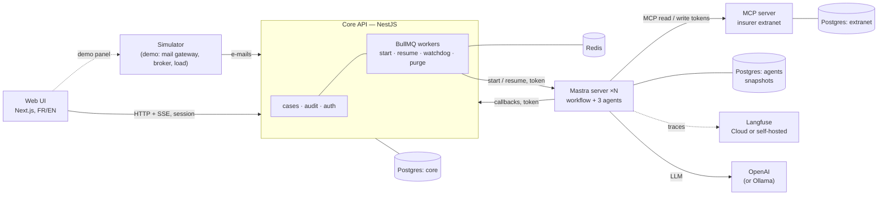

# Claims desk — AI agents for an insurance brokerage (demo)

A claim e-mail reaches a brokerage. Three AI agents read it, check the coverage at the insurer
through an MCP connector, and propose an action; a broker approves or rejects it before anything is
declared or sent, and every step is audited. Built as a demo for Panora — **all data is fictional**,
generated from a fixed seed.

> **En bref (FR).** Une démo de bout en bout du métier de Panora : un e-mail de sinistre arrive
> dans un cabinet de courtage, trois agents (tri, garanties, rédaction) l'analysent et interrogent
> l'extranet de l'assureur via un serveur MCP, puis un courtier valide l'action proposée (déclaration
> du sinistre, refus motivé, demande de pièces) avant son exécution, tracée dans un journal d'audit.
> Interface bilingue FR/EN, données FR/EN, tracing Langfuse, evals par agent et par langue avec
> non-régression en CI, comparaison chiffrée des modèles (coût, latence), tests de charge (1 000
> dossiers, extranet instable, instance tuée en cours de route) et moindre privilège des agents
> (jetons MCP `read` / `write`) testé en CI. Les specs (en français) sont dans [`specs/`](specs/), le détail de chaque version dans
> [`docs/versions/`](docs/versions/). Lancement : `npm install` puis `npm run dev`.

## The journey of a case

1. **E-mail in.** The mail gateway (the simulator, in the demo) posts the e-mail to Core, which
   opens a case and queues a job; the worker starts a Mastra workflow and returns at once.
2. **Triage** (`triageAgent`, light model): request type, the client (looked up in the brokerage's
   records with a `find_client` tool), policy number, date, peril, amount, documents present and
   missing, e-mail language — each fact with its source (e-mail, attachment page) and confidence.
3. **Coverage** (`coverageAgent`, read-only MCP tools on the insurer's extranet): policy status
   at the insurer — which may contradict what the brokerage believes (the flagship case: a policy
   terminated for non-payment that the brokerage still shows as active) — coverages, limits,
   deductibles, exclusions, claim history, declaration delay; a verdict (`covered`, `not_covered`,
   `uncertain`) with alerts and **verbatim clause citations**.
4. **Drafting** (`draftingAgent`, no tools): the action (`file_claim`, `notify_denial`,
   `request_documents`), the e-mail to the client in the client's language, and an internal note in
   the brokerage's language.
5. **Human approval.** The workflow suspends (snapshot in Postgres, survives restarts); the broker
   approves, or rejects with a comment that the drafting agent applies in a new proposal.
6. **Execution.** Only now, in code and with a separate `write` token, the claim is filed through
   MCP (`file_claim`); other actions become "ready to send". Everything lands in the audit trail,
   the UI follows each step and each tool call live (SSE), and Langfuse holds one trace per case.

## Architecture



| Service                                                        | Directory                                      | Port | Database   |
| -------------------------------------------------------------- | ---------------------------------------------- | ---- | ---------- |
| Web (Next.js 16, next-intl, shadcn/ui)                         | `apps/web`                                     | 3000 | —          |
| Core API (NestJS 12, Prisma, BullMQ)                           | `apps/core-api`                                | 3001 | `core`     |
| MCP extranet server (official TypeScript SDK, Streamable HTTP) | `apps/mcp-extranet`                            | 3002 | `extranet` |
| Simulator (demo tool)                                          | `apps/simulator`                               | 3003 | —          |
| Mastra server (workflow, agents)                               | `apps/agents`                                  | 4111 | `agents`   |
| Shared Zod contracts · fictional world generator               | `packages/shared` · `packages/world-generator` |      |            |
| Evals                                                          | `evals/`                                       |      |            |

One database per service, Zod on every boundary, Postgres on tmpfs and Redis without persistence:
every `npm run dev` starts from empty databases that the simulator seeds again.

## Design choices and trade-offs

- **Microservices around one product.** Core owns the business data and the audit; Mastra owns
  the reasoning and its snapshots; the MCP server plays the insurer's extranet behind the protocol
  Panora's connectors speak. More moving parts than a monolith, but each boundary is a real one
  (an insurer is another company; agents must not touch the brokerage's database) and is enforced
  by tokens and tested.
- **Three agents rather than one.** The measured single agent is as accurate and cheaper on a small
  sample (V8). Three agents are kept because each one is evaluated and traced on its own, a light
  model does the triage, only the analysis agent gets tools — read-only — and a rejected draft is
  rewritten without re-running the analysis.
- **Mastra in framework mode, behind Core.** Core never waits for a workflow (it starts or resumes
  and returns); progress comes back through callbacks; suspended runs survive restarts; several
  Mastra instances share their storage.
- **Least privilege by construction.** Agents only hold read tools; writes happen in a code step
  after human approval with a separate `write` token; the token carries the brokerage, so a prompt
  cannot reach another brokerage's policies.
- **One English prompt per agent for a bilingual product.** Structured outputs use neutral values;
  the languages are passed explicitly (draft in the e-mail's language, note in the brokerage's,
  clauses quoted in their own language); the UI renders stored `type + params`, so the timeline
  follows the UI language. Measured per language in the evals.
- **Langfuse, self-hostable.** Business audit in Core, technical detail (prompts, tokens, cost) in
  Langfuse; switching Cloud ↔ self-hosted is a `.env` change.
- **Cheap models, measured.** The defaults are small OpenAI models chosen with the comparison table
  below; the evals gate any prompt or model change in CI.

## Results at a glance

- **Evals** (real models, samples to fit the budget): 100 % on every strict scorer (request type,
  fields, language, verdict, limits, citations, action, amounts, languages) on 6 French and 4
  English cases; LLM judge for tone and completeness 75–83 %. A deliberately degraded prompt is
  blocked by the gate (`drafting/action_type` 100 → 50). [`evals/reports/`](evals/reports/)
- **Cost**: **$0.0034 per case** for the whole workflow (≈ 62 % of input tokens served from the
  prompt cache); triage on a smaller model halves it at equal score.
- **Load**: 1,000 cases in a burst against a flaky extranet (5 % errors) with a Mastra instance
  killed mid-run: **1,000 closed, 0 failed, 0 processed twice**, 299 cases/min (the rate limit).
- **Isolation**: MCP tokens are scoped to a brokerage and to `read` / `write`; suite green in CI.

## Run it locally

Requirements: Node.js 24, Docker.

```bash
npm install
npm run dev
```

On the first run `npm run dev` creates `.env` from `.env.example` with random secrets; set
`OPENAI_API_KEY` in it (or `AGENTS_MODE=simulated` to try everything without an LLM). It then starts
Postgres and Redis (empty), a self-hosted Langfuse, the five apps in watch mode, and seeds the
fictional world.

Open http://localhost:3000 — no sign-in: the demo has one brokerage (Delorme Courtage) and one
broker (Sophie Marchal), and every e-mail lands in her inbox. Press **Start** in the demo panel: e-mails arrive, the timeline fills up live, approve or reject the
proposals; switch the UI between FR and EN at any time. Other entry points: Mastra Studio on
http://localhost:4111, Langfuse on http://localhost:3100 (`demo@panora-demo.local` /
`demo-password`), the Evals screen, `npm run evals`, `npm run load-test -w apps/simulator`.

| Command                                                                    | What it does                                           |
| -------------------------------------------------------------------------- | ------------------------------------------------------ |
| `npm run dev` / `npm run dev:lite`                                         | the stack with self-hosted Langfuse on :3100 / without |
| `npm run build` / `lint` / `typecheck` / `test` / `test:integration`       | across all workspaces                                  |
| `npm run gen:evals -- --seed 7 --count 60` · `npm run evals [-- --matrix]` | eval dataset, eval run, model matrix                   |
| `npm run start:docker`                                                     | the full stack in containers (Compose profile `apps`)  |
| `npm run infra:down`                                                       | stop and remove the containers                         |

## Tracing: Langfuse, self-hosted by default

The Mastra server exports its traces to Langfuse: one trace and one session per case (initial run
and every resume), with the model, the prompt version and the e-mail language on the agents' spans,
and tokens and cost on every LLM call. The UI's audit log links to the trace.

- **Self-hosted (default)**: `npm run dev` starts Langfuse with the stack (web UI on
  http://localhost:3100, worker, ClickHouse, MinIO, Redis; Compose profile `langfuse`, no volume).
  The project, its keys and a login are created on startup and `.env.example` already points to
  them, so "View the trace" opens the local trace. `npm run dev:lite` skips Langfuse (tracing off,
  no trace links) for a smaller machine.
- **Cloud**: set `LANGFUSE_PUBLIC_KEY`, `LANGFUSE_SECRET_KEY`, `LANGFUSE_BASE_URL` and
  `NEXT_PUBLIC_LANGFUSE_URL` / `NEXT_PUBLIC_LANGFUSE_PROJECT_ID` in `.env` — same code, only the
  URL and the keys change.

### Why self-host in a regulated sector — and what it costs

- Traces contain prompts, claim e-mails, policy numbers and client names: personal and
  commercially sensitive data. Self-hosting keeps them inside the brokerage's infrastructure (and
  its hosting region), under its own access control and retention rules, with no extra
  sub-processor to declare.
- The cost is operational: five more containers (web, worker, ClickHouse, object storage, Redis)
  on top of Postgres, to size, monitor, upgrade (Langfuse ships often and ClickHouse migrations run
  on startup), secure (SSO, network policies) and back up (Postgres, ClickHouse and the bucket —
  deliberately not done here: the demo runs on tmpfs). Cloud is the better default until the data
  or contractual constraints require self-hosting.

## Cost, latency and model choice

Every model choice is backed by `npm run evals -- --matrix` (configurations in
[`evals/matrix.json`](evals/matrix.json)): each row changes one agent's model against the baseline,
or the architecture, or applies one optimisation. Models are switched **per case** (run options
passed from the eval runner through Core to Mastra), so the whole matrix runs against one server.
Cost comes from the Langfuse traces (sum of the LLM generations of the case), latency is the time
from `POST /emails` to the first proposal.

Sample: 6 cases per configuration (same cases for every row).

| Configuration             | Agent    | Model                                                       | Agent score |    FR |    EN | Cases correct | Cost / case | Latency p50 / p95 |
| ------------------------- | -------- | ----------------------------------------------------------- | ----------: | ----: | ----: | ------------: | ----------: | ----------------: |
| baseline                  | workflow | `openai/gpt-5-nano / openai/gpt-6-luna / openai/gpt-6-luna` |       100.0 | 100.0 | 100.0 |         100.0 |     $0.0034 |       78 s / 98 s |
| triage: gpt-4.1-mini      | triage   | `openai/gpt-4.1-mini`                                       |       100.0 | 100.0 | 100.0 |          66.7 |     $0.0033 |       32 s / 40 s |
| triage: gpt-5.4-nano      | triage   | `openai/gpt-5.4-nano`                                       |        97.2 |  95.8 | 100.0 |         100.0 |     $0.0018 |       31 s / 31 s |
| coverage: gpt-5.4-mini    | coverage | `openai/gpt-5.4-mini`                                       |        86.1 |  90.6 |  77.1 |         100.0 |     $0.0082 |       63 s / 65 s |
| coverage: gpt-4.1-mini    | coverage | `openai/gpt-4.1-mini`                                       |        83.3 |  87.5 |  75.0 |         100.0 |     $0.0096 |       64 s / 79 s |
| drafting: gpt-5-nano      | drafting | `openai/gpt-5-nano`                                         |        94.4 |  91.7 | 100.0 |          83.3 |     $0.0047 |      97 s / 107 s |
| drafting: gpt-4.1-mini    | drafting | `openai/gpt-4.1-mini`                                       |        88.9 |  91.7 |  83.3 |          83.3 |     $0.0036 |       56 s / 73 s |
| single agent (gpt-6-luna) | workflow | `openai/gpt-6-luna (one agent)`                             |       100.0 | 100.0 | 100.0 |         100.0 |     $0.0015 |       42 s / 65 s |
| reduced context           | workflow | `openai/gpt-5-nano / openai/gpt-6-luna / openai/gpt-6-luna` |        83.3 |  75.0 | 100.0 |          83.3 |     $0.0030 |       60 s / 73 s |

"Agent score" is the mean of the varied agent's scorers; "Cases correct" is the share of cases where
triage, verdict, action and amounts are all right.

**Reading it.** The sample is deliberately small (6 cases × 10 configurations ≈ $0.25 in API costs),
so one case flipping moves a column by 17 points: these numbers rank options, the full 60-case run
confirms them.

- **Triage**: `gpt-5.4-nano` scores like the baseline `gpt-5-nano` for **half the cost per case**
  ($0.0018 vs $0.0034) and less than half the latency: `gpt-5-nano` spends thousands of reasoning
  tokens on an extraction task. It is the next default to adopt once the full run confirms it.
  `gpt-4.1-nano` was also tried and is deprecated by OpenAI.
- **Coverage** is where quality is decided: the cheaper `gpt-5.4-mini` / `gpt-4.1-mini` keep the
  verdicts but lose points on alerts and citations, mostly on English cases, and cost _more_ per
  case (more tool round-trips and more tokens re-sent): `gpt-6-luna` stays.
- **Drafting**: `gpt-5-nano` and `gpt-4.1-mini` each picked a wrong action once: `gpt-6-luna` stays.
- **One agent vs three**: on this sample the single agent (same model, the three prompts merged) is
  as accurate and cheaper ($0.0015 vs $0.0034, one context instead of three). The three-agent
  design is kept for what the table does not show: a light model can do triage, each agent is
  evaluated and traced separately (a regression points to one prompt), the agents with tools are
  limited to read tools, and a rejected draft is rewritten without re-running the analysis.
- **Optimisations measured**:
  - _Prompt caching_: OpenAI caches stable prompt prefixes automatically; the agents' instructions
    come first and never change per case, so **62 %** of the input tokens of a baseline case are
    already served from the cache (75 % with the reduced context).
  - _Reduced context_ (photos dropped from the attachments, no attachments for the drafting agent):
    −12 % cost per case, 83 % of cases correct, above the 50 % threshold.
  - _Smaller model where the score holds_: triage on `gpt-5.4-nano` (above).
- **Local model**: `ollama/qwen3:4b` rows are in the matrix (`--with-ollama`, Compose profile
  `ollama`, `docker compose exec ollama ollama pull qwen3:4b`); not run here.

## Scale and resilience

`npm run load-test -w apps/simulator -- --count 1000` resets the demo, turns the simulated broker on
(immediate approval), sends a burst through the simulator (`POST /burst`, with ~5 % duplicate
e-mails) and follows Core's `/cases/metrics` until every case is closed.

**Setup of the reference run** (results in [`docs/load-tests/`](docs/load-tests/)): two Mastra
instances sharing their storage (Core round-robins and fails over between them), the extranet in
"flaky" mode (5 % of tool calls answered 503, 50–400 ms latency), BullMQ workers limited to 300
workflow starts per minute (the LLM quota we would buy), and **one Mastra instance killed (`kill -9`)
8 s into the burst**, while a hundred workflows were running on it. To keep the test free, the agents
run in `AGENTS_MODE=simulated`: the same workflows, MCP calls, suspension, approval and resume, with
deterministic stand-ins (4 s per agent) instead of LLM calls.

| Measure                                                            |                                                             1,000-case burst |
| ------------------------------------------------------------------ | ---------------------------------------------------------------------------: |
| Cases created / closed / failed                                    |                                                        1,000 / 1,000 / **0** |
| Duplicate e-mails sent / extra cases                               |                                    43 / **0** (1,000 distinct workflow runs) |
| Throughput                                                         |                                           **299 cases/min** (the rate limit) |
| Duration per case (reception → closed), p50 / p95                  |                            86 s / 191 s (mostly queueing behind the limiter) |
| Runs interrupted by the killed instance, restarted by the watchdog |                                                                          104 |
| Extranet errors injected / MCP retry rate                          |                                                    205 / 2.9 % of tool calls |
| Definitive failure rate                                            |                                                                      **0 %** |
| LLM cost of the test                                               | $0 (simulated) — about **$3.40** with the real models ($0.0034 per case, V8) |

How it holds:

- **No double processing**: job id = e-mail id, `messageId` unique in Core, and the worker claims a
  case atomically before creating its run.
- **Retries everywhere, with increasing delays**: BullMQ jobs (3 attempts), each MCP tool call
  (4 attempts on timeouts, 429 and 5xx — invisible to the broker when it succeeds), each workflow
  step (3 attempts), and explicit timeouts on every HTTP, MCP and LLM call.
- **Instance loss**: Core fails over to another Mastra instance; a watchdog (BullMQ repeated job,
  every 30 s) restarts the runs that stopped progressing from their last snapshot, re-sends lost
  resumes, and marks a case failed after 3 restarts. Failed cases show their reason in the UI and
  can be relaunched.
- Two bugs were found by these tests and fixed: the watchdog re-queued cases that were only
  waiting behind the rate limiter (now it skips cases with a pending job), and a stopping Core waited
  forever for open SSE streams (they now complete on shutdown, and the SSE client reconnects after
  45 s of silence).

## Security and personal data

**Access.** The demo runs locally for a single broker, so the UI has no sign-in (V12; V10 had
sessions and per-brokerage filtering, removed to keep the demo about the agents). Every decision
is recorded under that broker, and decisions of the simulated broker are marked "auto". The
brokerage's `brokerCode` travels with the case to Mastra and into the MCP token, so an agent
cannot read another brokerage's policies at the insurer whatever its prompt says. Each hop has
its own credential: inbound e-mail gateway → Core, Core → Mastra, Mastra → Core, Mastra → MCP
(`read` for the agents, `write` only in the code step after approval), simulator → `/admin/*`
(which only exists with `DEMO_MODE=true`). These rules are covered by test suites that run in CI
(Core API and MCP server, real Postgres).

**Data processed.** Claim e-mails and their attachments (names, addresses, company identifiers,
amounts, circumstances of incidents), policy data from the insurer, drafts and internal notes, the
brokers' decisions. All data in this demo is generated: no real person is involved.

| Where                      | What                                                 | Kept                                                     |
| -------------------------- | ---------------------------------------------------- | -------------------------------------------------------- |
| Core (`core` database)     | cases, e-mails, steps, proposals, decisions          | the case file's legal retention (not purged by the demo) |
| Core `AuditLog`            | who did what, when                                   | append-only: no route updates or deletes it              |
| Mastra (`agents` database) | workflow snapshots (e-mail, extracted facts, drafts) | purged `RETENTION_DAYS` (30) after the case closes       |
| Langfuse                   | prompts, completions, tokens, costs                  | trace deleted with the snapshot                          |
| Redis                      | jobs in flight                                       | short-lived (completed jobs trimmed)                     |

The purge is a BullMQ repeated job in Core: it asks Mastra to delete the snapshots and the Langfuse
traces of cases closed for longer than the retention delay, marks the case and writes an audit row.

**What production would add**: encryption at rest (database, backups, object storage) and in
transit between services (TLS/mTLS), hosting in France (HDS-grade providers are not required for
claims data, but EU hosting and a data processing agreement with the LLM provider are), secrets in a
vault with rotation, SSO for brokers with MFA, periodic access reviews, a records-of-processing
entry and a DPIA for the automated analysis, PII redaction in traces, and a retention policy agreed
with the brokerage's DPO for the case files themselves.

## Deployment

`npm run start:docker` builds one image per app (`turbo prune --docker`) and starts the whole stack
with Compose. To put the demo online on a VPS with Dokploy, see
[`docs/deployment.md`](docs/deployment.md).
