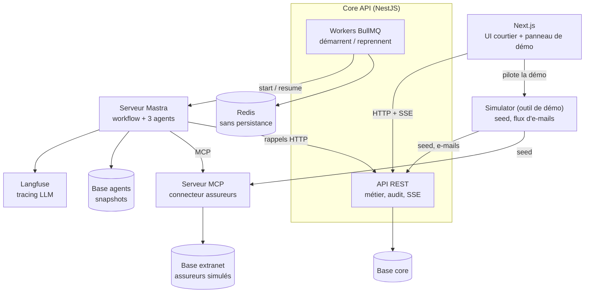

# Démo agents IA courtage (Panora) — Vue d'ensemble

> Résumé global du projet. Le détail de chaque version est dans `v01-…md` à `v15-…md` ; les données et scénarios de la démo sont dans `00-demo-data-and-scenarios.md`.
> Les specs sont rédigées en français ; **tout le code est en anglais** (identifiants, routes, tables, outils MCP, événements, commits).

## 1. Objectif

Un e-mail de sinistre arrive dans un cabinet de courtage. Trois agents IA l'analysent, vérifient les garanties chez l'assureur via un connecteur MCP, puis le courtier valide l'action proposée avant qu'elle soit exécutée et tracée.

La démo prouve les exigences de la fiche *Founding Senior Full Stack Engineer* de Panora :

| Exigence de la fiche | Où c'est prouvé |
| --- | --- |
| Full stack typé, solide en back-end | Toute la stack (TypeScript, NestJS, Next.js) |
| Architecture portée en production : modèle de données, API, jobs en arrière-plan | V3 (Core, BullMQ), V9 (échelle) |
| Fonctionnalité LLM / agent mesurée par evals, tracing, non-régression | V5 (tracing), V7 (evals + CI) |
| Réflexes qualité : tests, CI, revue, observabilité, incidents | V7, V9, V10 |
| Frameworks d'agents, évaluation de prompts et de modèles, coût et latence | V1–V2 (Mastra), V8 |
| Environnement réglementé : audit, accès, RGPD | V2, V10 |

## 2. Stack

| Couche | Choix |
| --- | --- |
| Langage | TypeScript partout (Node.js 24) |
| Monorepo | npm workspaces + Turborepo |
| Front | Next.js (App Router) + Tailwind + shadcn/ui + next-intl (FR / EN) |
| Back métier | NestJS + Prisma + PostgreSQL |
| Files de tâches | BullMQ + Redis |
| IA | Mastra en mode framework (serveur propre) ; modèles Claude ; Qwen via Ollama en V8 |
| Connecteur | Serveur MCP (SDK MCP officiel TypeScript, transport Streamable HTTP) |
| Tracing | Langfuse Cloud (V5), puis auto-hébergé (V6) |
| Contrats partagés | Zod dans `packages/shared` |
| Données fictives | `@faker-js/faker` (locales `fr`, puis `en` en V4), graine fixe |
| Infra locale | Docker Compose (`compose.yaml`) |
| CI | GitHub Actions |

## 3. Conventions

- **Code en anglais** : noms de fichiers, variables, tables, colonnes, routes, outils MCP, événements, messages de log, commits.
- **Une base par service** : personne ne lit la base d'un autre.
- **Zod partout** : toute donnée qui traverse un service (requête, rappel, sortie d'agent) est validée par un schéma de `packages/shared`.
- **Moindre privilège** : les agents n'ont que des outils en lecture ; toute écriture passe par une étape de code après validation humaine.
- **Données fictives uniquement**, générées avec une graine fixe (reproductibles).
- **Aucun volume Docker** : chaque `npm run dev` repart de bases vides, remplies automatiquement par le simulateur.
- **Interface bilingue** (FR / EN) dès V3 ; données générées en français jusqu'à V3, en français et en anglais à partir de V4.
- Chaque version se termine par une démo possible et des critères d'acceptation cochés.

### Glossaire métier → code

| Français (specs) | Anglais (code) |
| --- | --- |
| Cabinet de courtage | `Brokerage` |
| Courtier | `Broker` |
| Client (assuré) | `Client` |
| Assureur | `Insurer` |
| Contrat | `Policy` |
| Garantie | `Coverage` |
| Plafond | `limit` |
| Franchise | `deductible` |
| Clause des conditions générales | `Clause` |
| Sinistre | `Claim` |
| Dossier | `Case` |
| E-mail entrant / pièce jointe | `InboundEmail` / `Attachment` |
| Étape d'agent | `AgentStep` |
| Action proposée | `ProposedAction` |
| Journal d'audit | `AuditLog` |
| Agent Tri / Garanties / Rédaction | `triageAgent` / `coverageAgent` / `draftingAgent` |

## 4. Architecture

Core orchestre, Mastra réfléchit, le serveur MCP va chercher l'information chez l'assureur ; le simulateur joue le monde extérieur.



### Arborescence du monorepo

```
panora-demo/
├── package.json                  workspaces npm + scripts racine
├── package-lock.json
├── turbo.json                    pipeline dev / build / test
├── compose.yaml                  Postgres, Redis ; profils apps, langfuse, ollama
├── .env.example
├── apps/
│   ├── web/                      Next.js : UI courtier + panneau de démo
│   │   ├── messages/             fr.json, en.json (next-intl)
│   │   └── src/app/[locale]/     (inbox), cases/[id], audit, evals, demo
│   ├── core-api/                 NestJS : métier, audit, files BullMQ
│   │   ├── prisma/               schéma + migrations de la base core
│   │   └── src/
│   │       ├── brokerages/  clients/  policies/
│   │       ├── emails/           réception des e-mails entrants
│   │       ├── cases/            dossiers, actions proposées
│   │       ├── audit/            journal d'audit (écriture seule)
│   │       ├── internal/         routes de rappel appelées par Mastra
│   │       ├── admin/            seed + reset (mode démo uniquement)
│   │       ├── queues/           producteurs + processors BullMQ
│   │       ├── mastra-client/    client du serveur Mastra
│   │       └── realtime/         SSE vers l'UI
│   ├── agents/                   serveur Mastra (mode framework)
│   │   └── src/mastra/
│   │       ├── index.ts          instance Mastra : stockage, observabilité
│   │       ├── agents/           triage.ts, coverage.ts, drafting.ts
│   │       ├── prompts/          instructions des agents (en anglais)
│   │       ├── workflows/        process-email.ts, handle-claim.ts
│   │       ├── tools/            find-client.ts (HTTP vers Core)
│   │       ├── mcp/              clients MCP read / write
│   │       └── core-callbacks/   rappels HTTP vers Core
│   ├── mcp-extranet/             serveur MCP : connecteur assureurs
│   │   ├── prisma/               schéma + migrations de la base extranet
│   │   └── src/
│   │       ├── tools/            un fichier par outil MCP
│   │       ├── auth/             jetons read / write, cloisonnement
│   │       ├── admin/            seed + reset (mode démo uniquement)
│   │       └── chaos/            mode « extranet capricieux » (V9)
│   └── simulator/                outil de démo
│       └── src/
│           ├── seeding/          génère le monde et le pousse à Core et au MCP
│           ├── stream/           planificateur du flux d'e-mails
│           ├── auto-validation/  courtier simulé (option)
│           └── control/          API de pilotage du panneau de démo
├── packages/
│   ├── world-generator/          librairie : monde fictif, e-mails, vérité terrain
│   ├── shared/                   schémas Zod partagés
│   ├── tsconfig/
│   └── eslint-config/
├── evals/
│   ├── datasets/                 cas générés + vérité terrain
│   ├── scorers/                  un scorer par agent
│   └── run-evals.ts
├── infra/
│   └── postgres/init.sql         crée les bases core, agents, extranet
├── .github/workflows/            ci.yml, evals.yml
├── specs/                        ces fichiers
└── README.md
```

### Services et ports

| Service | Dossier | Port | Base | Arrive en |
| --- | --- | --- | --- | --- |
| Web (Next.js) | `apps/web` | 3000 | aucune | V3 |
| Core API (NestJS) | `apps/core-api` | 3001 | `core` | V3 |
| Serveur MCP extranet | `apps/mcp-extranet` | 3002 | `extranet` | V1 |
| Simulator | `apps/simulator` | 3003 | aucune | V1 (seed), V3 (flux, pilotage) |
| Serveur Mastra | `apps/agents` | 4111 | `agents` | V1 |
| PostgreSQL | `compose.yaml`, `tmpfs` | 5432 | 3 bases logiques | V1 |
| Redis | `compose.yaml`, sans persistance | 6379 | — | V3 |
| Langfuse | Cloud (V5), profil `langfuse` (V6) | 3100 en auto-hébergé | la sienne | V5 / V6 |

### Qui appelle qui

- Web → Core API : HTTP + SSE (le produit).
- Web → Simulator : pilotage de la démo.
- Simulator → Core API : seed, reset, envoi des e-mails, validations simulées (option).
- Simulator → serveur MCP : seed et reset de la base extranet.
- Core (workers BullMQ) → Mastra : démarrer et reprendre un workflow, sans attendre la fin.
- Mastra → Core : rappels HTTP sur `/internal/*`, jeton de service.
- Mastra → serveur MCP : protocole MCP, jeton `read` (agents) ou `write` (étape d'exécution).
- Mastra → Langfuse : export des traces en arrière-plan.

## 5. Workspaces, scripts et bases

### npm workspaces

- `package.json` racine : `"workspaces": ["apps/*", "packages/*", "evals"]`. Un seul `npm install`, un seul `package-lock.json`, un `node_modules` partagé à la racine.
- Paquets internes : `"@demo/shared": "*"` dans le `package.json` de l'app.
- Commande sur un seul workspace : `npm run dev -w apps/core-api`.
- Turborepo ordonne et parallélise les tâches, et met en cache.
- Images Docker : une par app, via `turbo prune --docker`.

### Scripts racine

| Script | Ce qu'il fait |
| --- | --- |
| `npm run dev` | (re)crée Postgres et Redis vides, puis lance les 5 apps en mode watch |
| `npm run dev:langfuse` | idem, avec Langfuse auto-hébergé (V6) |
| `npm run infra:down` | arrête et supprime les conteneurs |
| `npm run build` / `lint` / `typecheck` / `test` | sur tous les workspaces |
| `npm run gen:evals` | génère le jeu d'evals (V7) |
| `npm run evals` | exécute les evals (V7) |
| `npm run start:docker` | toute la stack en conteneurs, profil `apps` (V11) |

### Bases de données

- Postgres en `tmpfs`, Redis sans persistance : rien ne survit à un redémarrage.
- `infra/postgres/init.sql` crée `core`, `agents`, `extranet`.
- Core et le serveur MCP appliquent leurs migrations Prisma au démarrage ; Mastra crée ses tables au premier usage.
- Le simulateur attend Core et le MCP, génère le monde et l'envoie à leurs routes `POST /admin/seed`. Chaque service écrit dans sa propre base.

## 6. Le simulateur de démo

Outil de démo, hors produit : il joue le monde extérieur.

- **Seed** au démarrage et à chaque reset.
- **Flux d'e-mails** vers `POST /emails` de Core, à cadence réglable. Depuis V14, le flux suit un **script de démo** fini (X e-mails dans un ordre fixe, compteur n/X) au lieu d'un tirage sans fin.
- **États** : `ready`, `running`, `paused`, `finished` (V14).
- **API de pilotage** pour le panneau de démo : `GET /state`, `POST /start`, `/pause`, `/resume`, `/speed`, `/send-one`, `/reset`. La rafale et la validation automatique sont retirées en V14 ; le test de charge (`npm run load-test`) envoie lui-même ses e-mails.
- **Reset** : arrête le flux, vide Core (tables + files BullMQ) et l'extranet, refait le seed, remet le compteur à 0/X.
- Routes `/admin/*` de Core et du MCP actives seulement avec `DEMO_MODE=true` + jeton d'administration.

## 7. Langues

### Interface

Next.js bilingue FR / EN dès V3 (next-intl, préfixe `/fr` et `/en`, sélecteur de langue, dates et montants formatés selon la langue). Les étapes d'agents affichées dans la timeline sont stockées sous forme structurée (`type` + paramètres) et rendues par les fichiers de traduction : elles s'affichent dans la langue de l'interface, quelle que soit la langue de l'e-mail.

### Données

- V1 à V3 : tout le monde généré est en français.
- V4 : clients, e-mails et assureurs en anglais en plus (voir `v04-multilingual-data.md`).

### Prompts des agents : **un seul prompt, en anglais**, dès V1

- Les instructions des trois agents sont écrites en anglais, dans `apps/agents/src/mastra/prompts/`.
- Les sorties structurées utilisent des valeurs neutres en anglais (`covered`, `not_covered`, `uncertain`, `request_documents`…), donc indépendantes de la langue.
- Les règles de langue sont explicites dans le prompt : le brouillon d'e-mail au client est rédigé **dans la langue de l'e-mail reçu** ; la note interne pour le courtier **dans la langue du cabinet** (`Brokerage.locale`) ; les citations de clauses sont recopiées **dans leur langue d'origine**.
- Pourquoi pas un prompt par langue : deux prompts à maintenir, à évaluer et à garder synchronisés, pour un gain nul.
- Pourquoi pas des prompts en français : ça marche, mais les modèles suivent un peu plus régulièrement des instructions en anglais, et c'est la norme d'une équipe tech. Écrits en anglais dès V1, ils n'ont pas à être réécrits en V4.

## 8. Feuille de route

| Version | Objet | Fichier |
| --- | --- | --- |
| V1 | Noyau IA : MCP + agents Triage et Coverage, dans Mastra Studio | `v01-ai-core.md` |
| V2 | Workflow complet, validation humaine, écriture MCP | `v02-full-workflow.md` |
| V3 | Core API + Next.js bilingue + simulateur : démo de bout en bout | `v03-core-and-ui.md` |
| V4 | Données générées en anglais (multilingue) | `v04-multilingual-data.md` |
| V5 | Tracing Langfuse Cloud + timeline en direct | `v05-tracing-cloud.md` |
| V6 | Langfuse auto-hébergé | `v06-tracing-self-hosted.md` |
| V7 | Evals et non-régression en CI | `v07-evals.md` |
| V8 | Coût, latence, comparaison de modèles | `v08-cost-latency.md` |
| V9 | Échelle et résilience | `v09-scale-resilience.md` |
| V10 | Sécurité et conformité | `v10-security-compliance.md` |
| V11 | Finitions pour la candidature | `v11-finishing.md` |
| V12 | Un seul courtier, sans connexion ; Langfuse local par défaut | `v12-single-broker.md` |
| V13 | Boîte de réception vivante : statuts des agents en direct | `v13-live-inbox.md` |
| V14 | Démo scénarisée (n/X e-mails) et vrais PDF | `v14-scripted-demo.md` |
| V15 | Toutes les demandes : résiliation, information, relances, réponse au client, « à traiter par vous » | `v15-requests-and-replies.md` |

### Minimum pour postuler

**V1 → V3 + V5 + V7** : architecture, agents sur un vrai connecteur MCP, validation humaine, tracing et evals. V4 et V6 peuvent attendre ; V8 et V9 sont ce qui différencie.

## 9. Extensions possibles (Vn)

| Extension | Ce qu'elle apporte |
| --- | --- |
| RAG sur les conditions générales (pgvector), evals de fidélité aux sources | coche le RAG de la fiche |
| Un connecteur par assureur : faux extranet en API REST + serveur MCP adaptateur | reproduit leur produit « Connecteurs » |
| Workflow de renouvellement | workflows longs à plusieurs étapes validées |
| Création de client depuis un Kbis | extraction de document + écriture dans le logiciel du cabinet |
